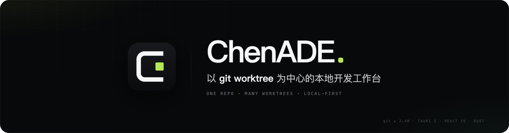
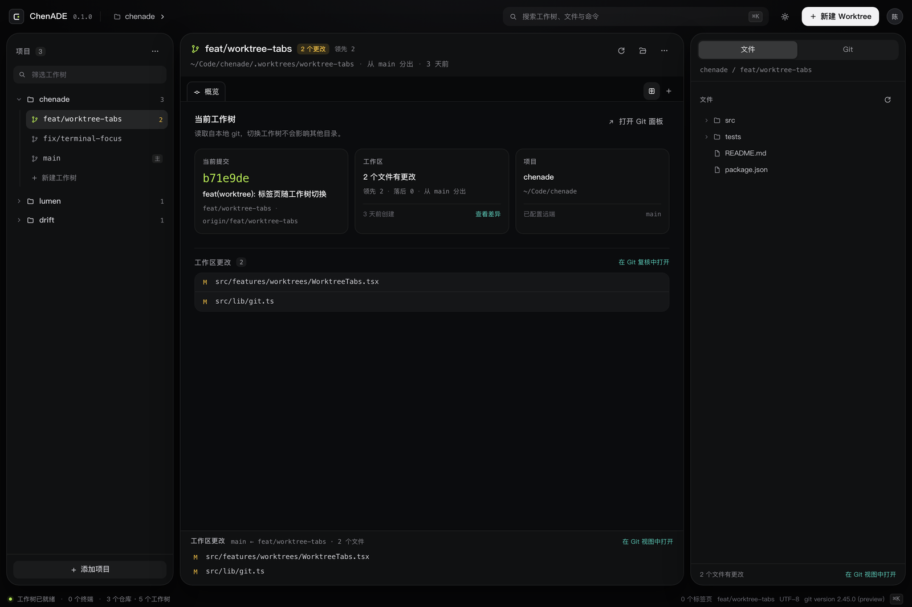
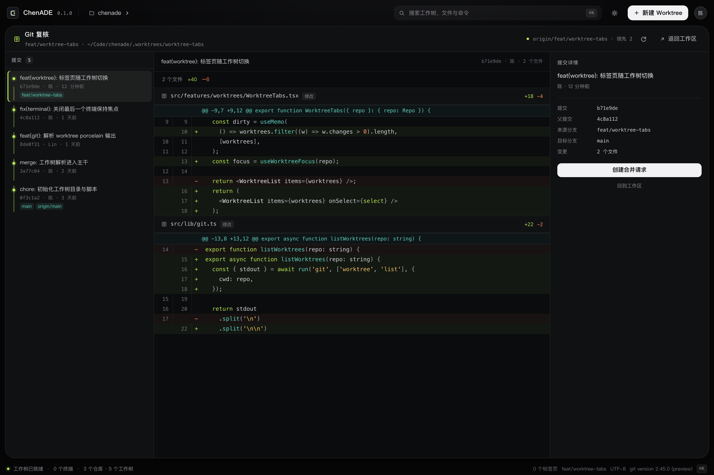
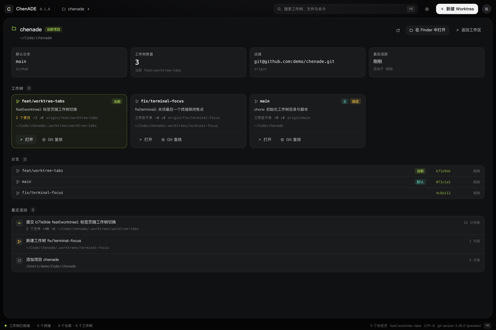
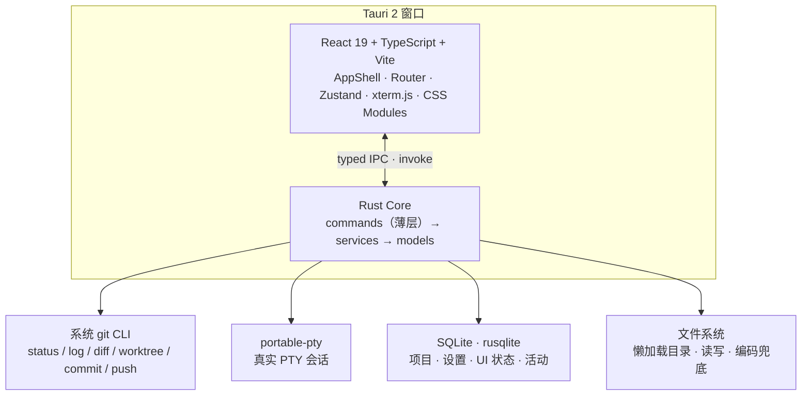

<div align="center">
  
</div>

<p align="center">
  
  
  
  
  
  
  
</p>

<p align="center">
  <a href="#快速开始">快速开始</a> ·
  <a href="#截图">截图</a> ·
  <a href="#核心特性">核心特性</a> ·
  <a href="#架构">架构</a> ·
  <a href="#快捷键">快捷键</a> ·
  <a href="#许可">许可</a>
</p>

---

**ChenADE 把 `git worktree` 从一条命令，变成一张工作台。**

同一个仓库里并行开 `feat/a`、`fix/b` 和 `main`：每个工作树都有自己的标签页、终端、文件树和 Git 记录。切换工作树时，一整套上下文跟着切换，而不是把同一堆标签页反复关掉再重开。

你常用的 agent CLI（`claude`、`codex`、`opencode`……）依然运行在真实 PTY 里。ChenADE 不解析它的输出、不弹审批卡、不做聊天壳——终端就是终端。

<br/>

## 为什么需要它

同时推进多个分支时，常见做法都有摩擦：

| 做法 | 代价 |
| --- | --- |
| 反复 `git switch` | 未提交改动要 stash，依赖可能重装，终端历史与滚动位置丢失，思路被打断 |
| 复制多份仓库 | 磁盘翻倍，`.git` 各自为政，缓存放好几份，最后分不清哪份最新 |
| 开多个编辑器窗口 | 终端、文件、Git 散落在不同窗口，工作树和分支的对应关系全靠记忆 |

`git worktree` 解决了目录隔离与共享对象库的问题，但一直缺少一个顺手的桌面工作台。ChenADE 就是补上这一层，并且**只补这一层**：不拦截 agent、不做账号、不上传代码。

<br/>

## 核心特性

| 能力 | 说明 |
| --- | --- |
| **工作树即上下文** | 每个工作树独立保存标签页、终端会话、文件树展开状态与 Git 面板；切换工作树 = 切换整套工作区，切回来滚动位置还在 |
| **真实 PTY 终端** | Rust 侧 `portable-pty` + 前端 `xterm.js`，多标签、自动 resize、复制粘贴、进程退出提示；agent CLI 的 TUI 原样保留 |
| **30 秒新建工作树** | 选仓库、分支名、起点分支、目录；可选复制 `.env.local`、安装依赖、创建后自动开终端；底部实时预览将要执行的 `git worktree add …` |
| **Git 在视线内** | 工作树状态、逐文件 diff、提交列表、提交详情、commit / push、打开远端 compare URL；写操作一律由你点击触发 |
| **文件树与代码查看** | 懒加载目录、Git 状态标记、语法高亮、UTF-8 内联编辑与保存、大文件与二进制兜底、一键交给系统编辑器或 Finder |
| **键盘优先** | `⌘K` 全局搜索工作树 / 文件 / 命令，`⌘⇧N` 新建工作树，`⌘1…9` 切标签，`⌘⇧G` 进 Git 复核 |
| **本地优先** | 项目、设置、UI 状态、最近活动全部落在本地 SQLite；无账号、无遥测、无后台服务 |
| **三端可构建** | macOS 为一等公民，Windows / Linux 保持同一套代码可构建，路径与 shell 探测按平台处理 |

<br/>

## 截图

<div align="center">
  
  <p><sub>工作区 —— 左栏项目与工作树、中间工作树概览、右栏文件 / Git 面板</sub></p>
</div>

<div align="center">
  
  <p><sub>Git 复核 —— 提交列表 + 逐文件 diff + 提交详情与 compare URL</sub></p>
</div>

<div align="center">
  
  <p><sub>项目总览 —— 统计、工作树卡片、分支列表与最近活动</sub></p>
</div>

<br/>

## 快速开始

**环境要求**

- macOS 12+（主力开发与验收平台）、Windows 10+、Linux（可构建）
- [Node.js](https://nodejs.org/) 20+ 与 [pnpm](https://pnpm.io/) 9+
- [Rust](https://www.rust-lang.org/tools/install) 1.77.2+
- 系统安装 `git ≥ 2.40`（应用启动时会检测并提示）

```bash
# 1. 拉取代码
git clone https://github.com/your-name/chenade.git
cd chenade

# 2. 安装前端依赖
pnpm install

# 3. 启动桌面应用（首次会编译 Rust，需要几分钟）
pnpm tauri dev
```

**打包**

```bash
pnpm build          # 前端类型检查 + 产物
pnpm tauri build    # 生成 .app / .dmg（按平台）
```

**只想看界面？**

```bash
pnpm dev            # 浏览器预览：走内置 mock 适配层，不依赖原生能力
```

**测试**

```bash
pnpm test                                              # 前端单测（Vitest）
cargo test --manifest-path src-tauri/Cargo.toml        # Rust 单测
```

<br/>

## 上手路径

1. **添加项目** —— 选择一个本地 git 仓库，ChenADE 会读取默认分支、远端与已有工作树。
2. **新建工作树** —— `⌘⇧N`，填分支名与起点，确认目录；需要的话勾选复制 `.env.local`、安装依赖、启动终端。
3. **在终端里干活** —— `⌘T` 新开终端，工作目录默认落在当前工作树；agent CLI、dev server、测试想开几个开几个。
4. **查看代码与改动** —— 右栏文件树带 Git 状态标记，点开就是高亮代码；`⌘J` 展开当前工作树的改动面板。
5. **提交与推送** —— Git 面板里写提交信息，按钮旁边永远能看到将要执行的 git 命令；需要评审时 `⌘⇧G` 进复核页，一键打开远端 compare URL。

<br/>

## 快捷键

| 快捷键 | 动作 | 快捷键 | 动作 |
| --- | --- | --- | --- |
| `⌘K` / `⌘P` | 全局搜索工作树、文件、命令 | `⌘B` | 显示 / 隐藏右栏 |
| `⌘⇧N` | 新建 Worktree | `⌘J` | 显示 / 隐藏底部更改面板 |
| `⌘T` | 新建终端 | `⌘R` | 刷新工作树状态 |
| `⌘W` | 关闭当前标签 | `⌘⇧G` | 打开 Git 复核 |
| `⌘1…9` | 切换标签 | `⌘,` | 设置 |
| `Esc` | 关闭覆盖层 / 取消 | | |

> macOS 使用 `⌘`，Windows / Linux 对应 `Ctrl`。

<br/>

## 架构



设计取舍：**Git 走系统 `git` CLI**，不引入 libgit2——解析 porcelain v2 输出，行为与你在终端里敲的命令完全一致；终端交给真正的 PTY，不做协议层；所有平台能力收在 Rust `services/`，前端只通过 `src/lib/ipc.ts` 一个入口调用。

**技术栈**

| 层 | 选择 |
| --- | --- |
| 桌面壳 | Tauri 2（Rust） |
| 前端 | React 19 + TypeScript strict + Vite |
| 状态 | Zustand（按 feature 分 store） |
| 路由 | React Router（桌面内 hash 路由） |
| 终端 | xterm.js + fit addon；Rust `portable-pty` |
| Git | 系统 `git` CLI（≥ 2.40） |
| 持久化 | SQLite（`rusqlite`，bundled） |
| 样式 | CSS Modules + CSS variables，无 UI 组件库 |
| 测试 | Vitest（前端）、`cargo test`（Rust） |

**目录**

```text
.
├── assets/               品牌资产与 README 截图
├── public/               favicon
├── src/                  React 前端
│   ├── app/              应用壳、路由、工作区 / 项目总览 / Git 复核
│   ├── components/       通用组件（Button / Pill / Kbd / CommandPalette…）
│   ├── features/         worktrees · terminals · files · git · tabs · settings
│   ├── lib/              IPC 客户端、类型、格式化、语法高亮
│   └── styles/           tokens.css / global.css
└── src-tauri/
    ├── src/commands/     Tauri command 薄层
    ├── src/services/     git · pty · fs · db · search · platform
    ├── src/models/       serde 类型
    ├── icons/            应用图标（由 assets/brand/mark.svg 生成）
    └── tauri.conf.json
```

<br/>

## 设计

深色、安静、信息密度高。界面由三块 20px 圆角的“岛”组成，强调色只有一支荧光绿，其余靠层级与留白说话。

| Token | 值 | 用途 |
| --- | --- | --- |
| `--bg-app` | `#070708` | 应用背景 |
| `--bg-island` | `#101112` | 岛 / 面板 |
| `--bg-content` | `#0B0C0E` | 代码与终端区 |
| `--lime` | `#B5E655` | 主强调、激活、新增 |
| `--amber` | `#F7C548` | 脏状态、等待 |
| `--coral` | `#FF8A5C` | 删除、错误 |
| `--teal` | `#5FD0BE` | 链接、函数 |
| `--text-1` | `#F4F4F5` | 主文本 |

**标识**：一块方角 `C`，缺口里放一个荧光绿方块——`C` 是 Chen，方块是终端里那个一直在等你的光标。图形只有两个形状、一种强调色，16px 下仍然清楚。

| 文件 | 用途 |
| --- | --- |
| `assets/brand/mark.svg` | 应用图标（深色圆角底） |
| `assets/brand/mark-glyph.svg` | 透明底图形，用于深色背景 |
| `assets/brand/mark-mono.svg` | 单色版，用于印刷或单色场景 |
| `assets/brand/banner.png` | README / 社交预览头图 |
| `assets/brand/identity.png` | 标识总览（尺寸阶梯、单色与产品内效果） |

<br/>

## 隐私

ChenADE 是本机工具，不是云服务：

- **不联网**：没有账号、没有同步、没有遥测、没有崩溃上报。
- **唯一的网络动作**：你主动点击“创建合并请求”时，用系统浏览器打开远端 compare URL。
- **数据都在本地**：项目列表、设置、UI 状态、最近活动存在本地 SQLite；终端进程随应用退出结束。
- **不碰密钥**：不存储 OAuth token，不读取 `.env` 内容（新建工作树时只做文件复制）。

<br/>

## 项目状态

`v0.1.0` · 开发者预览。macOS 全流程可用；Windows / Linux 保持可构建，但尚未做完整验收，请以实际平台表现反馈问题。

目前已经可用：项目管理、工作树列表 / 新建 / 删除 / prune、真实终端、文件树与代码编辑、Git 状态与 diff、commit / push、Git 复核、项目总览、最近活动、设置、全局搜索。

<br/>

## 参与贡献

欢迎 issue 与 PR。为了避免来回折腾，提交前请确认：

1. 改动聚焦，一个可验证的变更一个 commit，message 使用 `feat|fix|refactor|test|docs|chore(scope): …`。
2. 本地通过 `pnpm typecheck`、`pnpm test`、`cargo test --manifest-path src-tauri/Cargo.toml`。
3. 不提交 `.env`、密钥、token、本地绝对路径、日志或数据库文件。
4. UI 改动附带截图（1440×960）。

<br/>

## 许可

[MIT](LICENSE) © ChenADE

<br/>

## 致谢

站在这些项目肩上：[Tauri](https://tauri.app/)、[React](https://react.dev/)、[Vite](https://vite.dev/)、[xterm.js](https://xtermjs.org/)、[portable-pty](https://github.com/wez/wezterm/tree/main/pty)、[rusqlite](https://github.com/rusqlite/rusqlite)、[Zustand](https://zustand.docs.pmnd.rs/)。

也谢谢每一个在终端里同时开三个 agent 的人——这个项目就是为你们写的。
